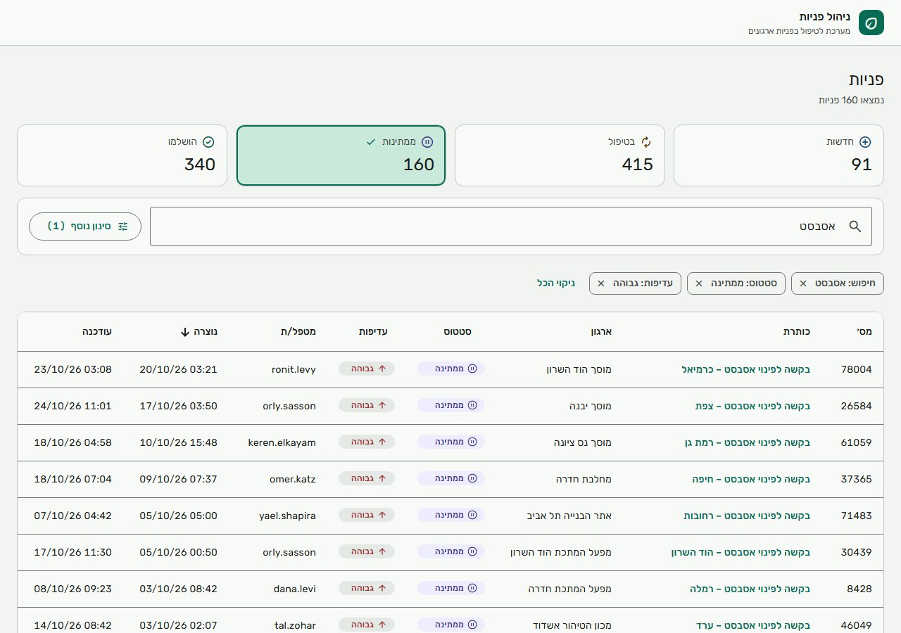
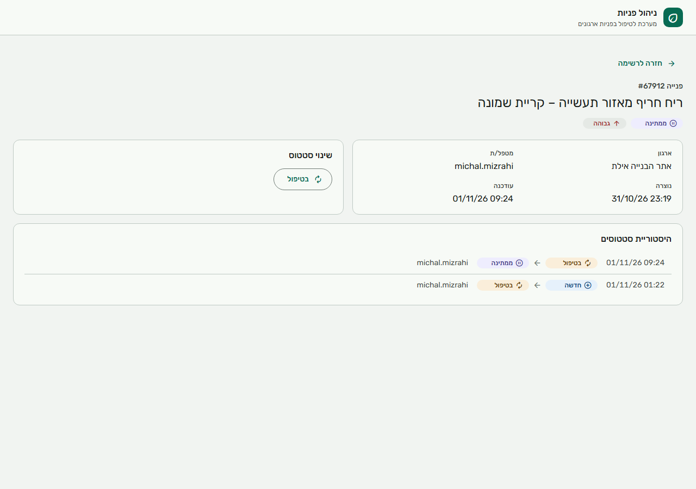

# מדריך לבודק

לכל דרישה: איך רואים אותה בממשק או ב-API, איפה הקוד, איזו בדיקה מכסה אותה, ואיפה היא מתועדת.
ההרצה מתוארת ב-[README](../README.md). הנתיבים יחסיים לשורש הפרויקט.

## דרישות ואיפה הן

| דרישה | איך רואים | קוד | בדיקה | תיעוד |
|---|---|---|---|---|
| **לפחות 10,000 רשומות** | בהרצה הראשונה נוצרות 100,000 פניות, והרשימה מציגה "נמצאו 100,000 פניות" | `Infrastructure/Persistence/Seeding/DataSeeder.cs` | `SeederTests` | [README](../README.md) |
| **דפדוף** | ה-Paginator בתחתית הטבלה, 20/50/100 בעמוד. העמוד נשמר ב-URL | `Application/Requests/Querying/RequestQueryService.cs`, `requests-table.component.ts` | `SearchRequestsTests`, `requests-table.component.spec.ts`, `requests-search.state.spec.ts` | [PERFORMANCE](PERFORMANCE.md) |
| **חיפוש** | שדה החיפוש מעל הטבלה, בכותרת ובשם הארגון, 300ms אחרי ההקלדה | `RequestFilters.cs`, `SearchPlan.cs`, `request-filters.component.ts` | `SearchRequestsTests`, `SearchPlanTests`, `request-filters.component.spec.ts` | [PERFORMANCE](PERFORMANCE.md), "חיפוש עם מעט התאמות" |
| **סינון** | כרטיסי הסטטוס, ו"סינון נוסף": שם הארגון, מטפל/ת, עדיפות, טווח תאריכים. כל סינון פעיל מופיע כצ'יפ שאפשר להסיר | `RequestFilters.cs`, `request-filters.component.ts`, `active-filter-chips.component.ts` | `RequestFiltersTests`, `SearchRequestsTests`, `active-filter-chips.component.spec.ts` | |
| **מיון** | לחיצה על כותרת עמודה (ארגון, סטטוס, עדיפות, נוצרה, עודכנה). `Id` שובר שוויון, כך ששורה לא מופיעה בשני עמודים | `RequestQueryService.cs` (`Sort`) | `SearchRequestsTests`, `requests-table.component.spec.ts` | [PERFORMANCE](PERFORMANCE.md), "האינדקסים ולמה" |
| **נתונים מסכמים** | ארבעת הכרטיסים מעל הטבלה. כל כרטיס מתעלם מהסינון של עצמו (Faceted), ולחיצה עליו מסננת | `Summary/RequestSummaryService.cs`, `summary-cards.component.ts` | `SummaryTests`, `summary-cards.component.spec.ts` | |
| **עדכון סטטוס ב-REST API** | `PATCH /api/requests/{id}/status` עם `{ status, rowVersion }` | `RequestsController.cs`, `Commands/RequestStatusService.cs`, `Domain/Requests/StatusTransitions.cs` | `UpdateStatusTests`, `StatusTransitionsTests` | [ADR 0004](adr/0004-rowversion-in-request-body.md) |
| **עדכון סטטוס בממשק** | לחיצה על כותרת פנייה → דף הפנייה → כפתור למעבר מותר. רק המעברים שהשרת מתיר מוצגים | `request-details-page.ts` | `request-details-page.spec.ts` | |
| **עדכונים מקבילים** | פותחים פנייה בשתי לשוניות, משנים בראשונה, ואז בשנייה: נפתח דיאלוג התנגשות עם המצב העדכני ומי שינה | `RequestStatusService.cs`, `conflict-dialog.component.ts` | `ConcurrencyTests`, `BulkConcurrencyTests`, `conflict-dialog.component.spec.ts` | [ADR 0004](adr/0004-rowversion-in-request-body.md) |
| **היסטוריית שינויים (Audit)** | בדף הפנייה: מי שינה, מתי, ומאיזה סטטוס לאיזה. נשמרת באותה טרנזקציה עם השינוי | `Domain/Requests/RequestStatusHistory.cs`, `RequestStatusService.cs` | `HistoryTests`, `ConcurrencyTests` | |
| **עדכון מרוכז (Bulk)** | `POST /api/requests/bulk-status`, עד 100 פניות, תוצאה לכל פנייה | `RequestStatusService.cs` (`BulkUpdateAsync`) | `BulkUpdateTests`, `BulkConcurrencyTests`, `BulkUpdateStatusRequestValidationTests` | [ADR 0005](adr/0005-bulk-partial-success.md) |
| **ביצועים** | `docs/PERFORMANCE.md`: לפני/אחרי, Logical Reads, תוכניות ריצה, זמני API | `ServiceRequestConfiguration.cs` (אינדקסים), `SearchPlan.cs` | `SchemaTests.Indexes_match_the_spec`, `SearchPlanTests` | [PERFORMANCE](PERFORMANCE.md) |
| **Cache** | הסיכום בלי סינון חוזר מה-Cache (כ-1ms), ומתעדכן מיד אחרי שינוי סטטוס | `Summary/SummaryCache.cs` | `SummaryCacheTests` | [ADR 0006](adr/0006-hybridcache-generation-key.md) |
| **טיפול בשגיאות** | שגיאה מוחזרת כ-ProblemDetails. בממשק: הודעה בעברית, ובשגיאת שרת קוד לתמיכה (`traceId`). ניתוק מהשרת מציג באנר ומנסה שוב | `ErrorHandling/GlobalExceptionHandler.cs`, `error.interceptor.ts`, `connection.interceptor.ts` | `PlatformTests`, `error.interceptor.spec.ts`, `connection.interceptor.spec.ts` | |
| **בדיקות אוטומטיות** | `dotnet test` ו-`npm test`. ה-CI מריץ את שתיהן בכל PR | `tests/`, `*.spec.ts` | | [README](../README.md), "בדיקות" |
| **תכנון עבודה** | משימות, תלויות, הערכה מול שעות בפועל, נקודות החלטה ולקחים | | | [WORK_PLAN](WORK_PLAN.md), [תוכנית מימוש](plans/2026-11-01-implementation-plan.md) |

## צילומי מסך

**רשימה עם חיפוש וסינון:** כרטיס "ממתינות" נבחר, חיפוש "אסבסט" ועדיפות גבוהה, וכל סינון כצ'יפ.



**דף פנייה:** פרטים, שינוי סטטוס (רק המעברים המותרים) והיסטוריה.



**דיאלוג ההתנגשות** נראה בממשק לפי התרחיש בשורה "עדכונים מקבילים" בטבלה.

## בדיקה מהירה של ה-API

```bash
# 20 הפניות החדשות ביותר בסטטוס "ממתינה" שמכילות "אסבסט"
curl "http://localhost:5150/api/requests?status=Waiting&search=%D7%90%D7%A1%D7%91%D7%A1%D7%98"

# הסיכום
curl "http://localhost:5150/api/requests/summary"

# שינוי סטטוס: ה-rowVersion מגיע מהתשובה של GET /api/requests/{id}
curl -X PATCH "http://localhost:5150/api/requests/1/status" -H "Content-Type: application/json" \
     -H "X-User-Name: reviewer" -d '{"status":"InProgress","rowVersion":"<rowVersion>"}'
```

שליחה חוזרת של אותה בקשה, עם אותו `rowVersion`, מחזירה 409 עם המצב העדכני.

## פתרון תקלות

| תקלה | פתרון |
|---|---|
| ה-API לא עולה: `A network-related or instance-specific error` | LocalDB לא מותקן או לא רץ. `sqllocaldb info` מציג את המופעים, ו-`sqllocaldb start MSSQLLocalDB` מפעיל |
| `Address already in use` על 5150 או 4200 | מופע קודם עדיין רץ. לסגור אותו, או לשנות פורט ב-`launchSettings.json` (וב-`proxy.conf.json` של הממשק) |
| `dotnet test` נכשל ב-`The file is locked by: "ServiceRequests.Api"` | ה-API רץ ונועל את הקבצים שהבדיקות בונות. לעצור אותו לפני הבדיקות |
| הממשק מציג "אין חיבור לשרת" | ה-API לא רץ. ה-Proxy מחזיר 502, והממשק מנסה שוב ומציג באנר עד שהשרת חוזר |
| `measure.ps1` נעצר: `running scripts is disabled` | ברירת המחדל של Windows חוסמת סקריפטים. להריץ עם `powershell -ExecutionPolicy Bypass -File docs\performance\measure.ps1` |
| עדכון סטטוס מחזיר 400 על משתמש | חסרה הכותרת `X-User-Name` (הממשק שולח אותה לבד) |
