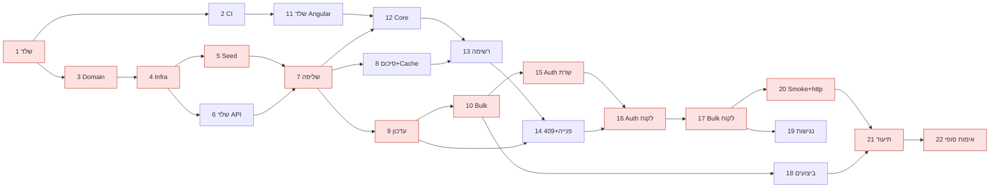

# Service Requests – תוכנית מימוש (Implementation Plan)

> **For agentic workers:** REQUIRED SUB-SKILL: Use superpowers:subagent-driven-development (recommended) or superpowers:executing-plans to implement this plan task-by-task. Steps use checkbox (`- [ ]`) syntax for tracking.

**Goal:** לבנות מערכת לניהול פניות (API ב-.NET 10 ו-UI ב-Angular) שעומדת בכל 11 סעיפי המבדק, עם הוכחות (בדיקות ומדידות) לכל טענה.

**Architecture:** N-Layer בארבעה פרויקטים (`Api → Application → Infrastructure → Domain`) מול SQL Server, ולקוח Angular שבו ה-URL הוא מקור האמת של מצב הרשימה. Concurrency אופטימי עם `rowversion` בגוף הבקשה, Bulk עם Partial Success, Cache לסיכום עם Generation Key.

**Tech Stack:** .NET 10 SDK 10.0.402, ASP.NET Core Controllers, EF Core 10, SQL Server (LocalDB / 2022 ב-CI), HybridCache, xUnit, Angular 22 + Angular Material, RxJS, Signals, GitHub Actions.

**Spec:** `docs/specs/2026-11-01-service-requests-design.md` – קראו אותו לפני כל משימה. מספרי §N מפנים לסעיפי המבדק.

---

## Global Constraints

- .NET SDK מקובע ב-`global.json` ל-`10.0.402` עם `rollForward: latestFeature`. כל הפרויקטים `net10.0`.
- `Nullable` = enable, `TreatWarningsAsErrors` = true, `AnalysisLevel` = `latest-recommended` – ב-`Directory.Build.props`. גרסאות חבילות רק ב-`Directory.Packages.props`.
- שמות: Solution `ServiceRequests.slnx`; פרויקטים `ServiceRequests.{Domain|Infrastructure|Application|Api}`, בדיקות `ServiceRequests.{UnitTests|IntegrationTests}`, לקוח `src/service-requests-ui`.
- Connection string: `ConnectionStrings:ServiceRequestsDb`. ברירת מחדל בפיתוח: `Server=(localdb)\MSSQLLocalDB;Database=ServiceRequests;Trusted_Connection=True;TrustServerCertificate=True`.
- פורט ה-API בפיתוח: `http://localhost:5150`. ה-UI: `http://localhost:4200` עם Proxy ל-`/api` ו-`/health`.
- Enums עם ערכים מפורשים: `RequestStatus { New=1, InProgress=2, Waiting=3, Completed=4 }`, `RequestPriority { Low=1, Medium=2, High=3 }`, `UserRole { Handler=1, Manager=2 }`. ב-JSON – כשמות (`JsonStringEnumConverter`), בכל תשובה כולל שגיאות.
- אורכים: Title 200, OrganizationName 200, AssignedTo 100, ChangedBy 100, search 100, UserName 50, DisplayName 100.
- כל התאריכים UTC (`datetime2(3)`); שעה נוכחית רק מ-`TimeProvider`.
- `pageSize` 1–100 (ברירת מחדל 20), `page ≥ 1`. Bulk: 1–100 פריטים.
- Cache: מפתח `requests:summary:v{generation}`, Expiration 60 שניות (`Cache:SummaryTtlSeconds`).
- JWT: Issuer `service-requests`, Audience `service-requests-ui`, תוקף 60 דקות, מפתח מ-`Jwt:SigningKey` (User Secrets / GitHub Secret), לא ב-Git.
- כל שגיאה = ProblemDetails עם `traceId`. 409 מכיל הרחבה `current` (RequestDetailsDto).
- Logging רק דרך `[LoggerMessage]`; אסור לרשום סיסמאות, טוקנים, גופי בקשות, Connection Strings. 409 נרשם ב-Information.
- Git: ענף לכל משימה (`feature/<issue>-<slug>`), commit-ים קטנים בציווי באנגלית, **ה-push, ה-PR וה-Merge – רק על ידי המשתמשת.** כל commit מסתיים ב-`Co-Authored-By: Claude Opus 5.5 <noreply@anthropic.com>`.
- UI בעברית RTL; נגישות לפי ת"י 5568 (WCAG 2.0 AA).

## Review Focus

1. **מונח חיפוש עם תווים מיוחדים של LIKE** (`50%`, `a_b`, `[x]`) – חייב להתפרש כטקסט מילולי, לא כ-Wildcard. → בדיקה ב-Task 7.
2. **גבול טווח תאריכים ואזור זמן** – פנייה שנוצרה ב-23:30 שעון ישראל ביום האחרון כלולה כש-`createdTo` הוא חצות היום הבא (`+02:00`/`+03:00`), ולא כלולה פנייה שנוצרה בדיוק ב-`createdTo`. → בדיקה ב-Task 7.
3. **עמוד אחרי הסוף** (`page=99999`) – 200 עם `items` ריק ו-`totalCount` נכון, לא 400 ולא 500. → בדיקה ב-Task 7.
4. **בקשת Bulk פגומה** – פריט `null`, מזהה כפול, 101 פריטים, `rowVersion` חסר – 400, ושום שורה לא משתנה. → בדיקה ב-Task 10.
5. **`rowVersion` לא תקין** (לא Base64, או אורך שונה מ-8 בתים) – 400 עם שם השדה, לא 500. → בדיקה ב-Task 9.

---

## תמונת מצב: משימות, זמנים ותלויות

ימי עבודה: יום 1 = 01/11 (תכנון) … יום 6 = 06/11 (הגשה). הערכות כוללות זמן הסבר ולמידה.

| # | משימה | § | יום | הערכה (שעות) | תלוי ב- |
|---|---|---|---|---|---|
| 1 | שלד הפתרון והגדרות Build | 10 | 1 | 1 | – |
| 2 | CI: Build, בדיקות ואיכות | 8, 10 | 1 | 1 | 1 |
| 3 | Domain: ישויות ומעברי סטטוס | 2 | 2 | 1.5 | 1 |
| 4 | Infrastructure: DbContext, אינדקסים, Migration, תשתית בדיקות | 1, 6 | 2 | 2 | 3 |
| 5 | Seed: 100,000 פניות, יצירה חוזרת | נתונים | 2 | 2 | 4 |
| 6 | שלד API: שגיאות, JSON, Health, Logging, ICurrentUser | 10 | 2 | 1.5 | 4 |
| 7 | שליפה: חיפוש, סינון, מיון, דפדוף, פנייה בודדת | 1 | 2 | 3 | 5, 6 |
| 8 | סיכום Faceted ו-Cache | 1, 7 | 3 | 2 | 7 |
| 9 | עדכון סטטוס, Concurrency, Audit והיסטוריה | 2, 3 | 3 | 3 | 7 |
| 10 | Bulk עם Partial Success | 4 | 3 | 3 | 9 |
| 11 | שלד Angular: Material, RTL, עברית, ESLint, CI | 5 | 4 | 1.5 | 2 |
| 12 | Core בלקוח: API, מודלים, Interceptors, באנר ניתוק | 5 | 4 | 1.5 | 11, 7 |
| 13 | מסך רשימה: State מה-URL, סינון, טבלה, סיכום | 5 | 4 | 4 | 12, 8 |
| 14 | מסך פנייה, היסטוריה ודיאלוג 409 | 5 | 4 | 2 | 13, 9 |
| 15 | אימות והרשאות בשרת (JWT, Roles) | 2, 3 | 5 | 2 | 10 |
| 16 | אימות בלקוח (Login, Guard, טוקן) | 5 | 5 | 1.5 | 15, 14 |
| 17 | Bulk בלקוח | 4, 5 | 5 | 1.5 | 16 |
| 18 | ביצועים: מדידה, אינדקסים, PERFORMANCE.md | 6 | 5 | 3 | 10 |
| 19 | נגישות ובדיקת Lighthouse | 5 | 6 | 1 | 17 |
| 20 | Smoke Test ב-CI ו-`requests.http` | 11 | 6 | 1.5 | 17 |
| 21 | תיעוד: README, מדריך לבודק, ADRs, GCP, AI, WORK_PLAN | 9, 11 | 6 | 3 | 18, 20 |
| 22 | אימות סופי: Code Review, עקיבות, כל הבדיקות ירוקות | הכול | 6 | 1.5 | 21 |
| S1 | (Stretch) בדיקת עומס NBomber | 6 | – | 3 | 18 |
| S2 | (Stretch) בדיקות לקוח נוספות | 8 | – | 1.5 | 17 |

**סיכום מאמץ:** משימות חובה – 44 שעות; Stretch – 4.5 שעות. יום 2 הוא העמוס ביותר (10 שעות) – אם הוא גולש, משימה 6 נדחית לבוקר יום 3.

**Critical Path:** 1 → 3 → 4 → 5 → 7 → 9 → 10 → 15 → 16 → 17 → 20 → 21 → 22.
עיכוב באחת מהן מעכב את ההגשה. משימות 8, 11, 18 ו-19 גמישות יותר.

**סדר ויתור אם הזמן נגמר:** S1 → S2 → Roles (משימות 15–17 נשארות עם התחברות בלבד) → בדיקת Filtered Index במשימה 18. אף פעם לא דרישת חובה.



## תהליך לכל משימה

1. ליצור Issue (כותרת = שם המשימה, תווית, Milestone של היום, Assignee = המשתמשת).
2. `git switch -c feature/<issue>-<slug>` מ-`main` מעודכן.
3. לבצע את הצעדים (TDD: בדיקה נכשלת → קוד → בדיקה עוברת → commit).
4. Self-review של ה-diff; במשימות 9, 10, 13, 15 – גם Code Review מתועד.
5. **המשתמשת:** `git push`, PR עם `Closes #<issue>`, Merge commit, מחיקת הענף.
6. לרשום שעות בפועל בעמודה של `docs/WORK_PLAN.md`.

---

## יום 1

### Task 1: שלד הפתרון והגדרות Build

**Files:**
- Create: `global.json`, `Directory.Build.props`, `Directory.Packages.props`, `.editorconfig`, `ServiceRequests.slnx`
- Create: `src/ServiceRequests.{Domain,Infrastructure,Application,Api}/*.csproj`, `tests/ServiceRequests.{UnitTests,IntegrationTests}/*.csproj`

**Interfaces:**
- Produces: הפניות בין פרויקטים – `Infrastructure → Domain`, `Application → Domain, Infrastructure`, `Api → Application` (+ `Infrastructure` רק לצורך `AddInfrastructure`/אתחול DB), `UnitTests → Domain, Application`, `IntegrationTests → Api`.

- [ ] **Step 1:** `dotnet new globaljson --sdk-version 10.0.402 --roll-forward latestFeature`; `dotnet new sln --format slnx -n ServiceRequests`.
- [ ] **Step 2:** `dotnet new classlib` ל-Domain/Infrastructure/Application, `dotnet new webapi --use-controllers` ל-Api, `dotnet new xunit` לשני פרויקטי הבדיקות; `dotnet sln add` לכולם; `dotnet add reference` לפי ה-Interfaces. למחוק קבצי דוגמה (`Class1.cs`, `WeatherForecast*`).
- [ ] **Step 3:** `Directory.Build.props` עם הערכים מ-Global Constraints; `Directory.Packages.props` עם `ManagePackageVersionsCentrally=true`; `.editorconfig` (`dotnet new editorconfig`).
- [ ] **Step 4:** לאמת: `dotnet build` → `Build succeeded. 0 Warning(s) 0 Error(s)`; `dotnet test` → רץ ללא בדיקות או עם בדיקת הדוגמה.
- [ ] **Step 5: Commit** – `Add solution skeleton with shared build configuration`.

### Task 2: CI – Build, בדיקות ואיכות

**Files:** Create: `.github/workflows/ci.yml`

**Interfaces:**
- Consumes: Task 1.
- Produces: Job בשם `backend` (Ubuntu, service container `mcr.microsoft.com/mssql/server:2022-latest` עם Health Check), משתנה סביבה `SERVICEREQUESTS_TEST_SQL` = connection string בלי Database. Job `frontend` יתווסף ב-Task 11, `smoke` ב-Task 20.

- [ ] **Step 1:** Workflow שרץ על `pull_request` ו-`push` ל-`main`: `actions/checkout`, `actions/setup-dotnet` (קורא את `global.json`), `dotnet build -warnaserror`, `dotnet test`.
- [ ] **Step 2:** סיסמת `sa` של ה-Container – ערך פיתוח בתוך ה-Workflow (Container זמני); מפתח JWT יגיע מ-`secrets.JWT_SIGNING_KEY` (יתווסף ב-Task 15).
- [ ] **Step 3:** לאמת מקומית: `dotnet build -warnaserror` עובר.
- [ ] **Step 4: Commit** – `Add CI workflow for backend build and tests`.
- [ ] **Step 5 (המשתמשת, אחרי ה-Merge):** Branch Protection על `main` – Require status checks (`backend`), Require PR.

---

## יום 2

### Task 3: Domain – ישויות ומעברי סטטוס

**Files:**
- Create: `src/ServiceRequests.Domain/Requests/{RequestStatus,RequestPriority,ServiceRequest,RequestStatusHistory,StatusTransitions,StatusTransitionNotAllowedException}.cs`, `src/ServiceRequests.Domain/FieldLengths.cs`, `src/ServiceRequests.Domain/Users/{User,UserRole}.cs`
- Test: `tests/ServiceRequests.UnitTests/Domain/StatusTransitionsTests.cs`, `.../Domain/ServiceRequestTests.cs`

**Interfaces:**
- Produces:
  - `static class StatusTransitions { bool IsAllowed(RequestStatus from, RequestStatus to); IReadOnlyList<RequestStatus> AllowedFrom(RequestStatus from); }`
  - `class ServiceRequest { int Id; string Title; string OrganizationName; RequestStatus Status; RequestPriority Priority; string? AssignedTo; DateTime CreatedAt; DateTime UpdatedAt; byte[] RowVersion; RequestStatusHistory ChangeStatus(RequestStatus newStatus, string changedBy, DateTime utcNow); }` – זורק `StatusTransitionNotAllowedException(RequestStatus from, RequestStatus to)` במעבר אסור; מעדכן `Status` ו-`UpdatedAt`; מחזיר שורת היסטוריה חדשה.
  - `class RequestStatusHistory { long Id; int RequestId; RequestStatus PreviousStatus; RequestStatus NewStatus; DateTime ChangedAt; string ChangedBy; }`
  - `static class FieldLengths` עם הקבועים מ-Global Constraints.
  - `class User { int Id; string UserName; string DisplayName; string PasswordHash; UserRole Role; }`

- [ ] **Step 1: בדיקות נכשלות**

```csharp
[Theory]
[InlineData(RequestStatus.New, RequestStatus.InProgress)]
[InlineData(RequestStatus.InProgress, RequestStatus.Waiting)]
[InlineData(RequestStatus.InProgress, RequestStatus.Completed)]
[InlineData(RequestStatus.Waiting, RequestStatus.InProgress)]
public void Allowed_transitions_are_allowed(RequestStatus from, RequestStatus to)
    => Assert.True(StatusTransitions.IsAllowed(from, to));

[Theory]
[InlineData(RequestStatus.New, RequestStatus.Completed)]
[InlineData(RequestStatus.New, RequestStatus.Waiting)]
[InlineData(RequestStatus.Waiting, RequestStatus.Completed)]
[InlineData(RequestStatus.Completed, RequestStatus.InProgress)]
[InlineData(RequestStatus.InProgress, RequestStatus.InProgress)]
public void Other_transitions_are_rejected(RequestStatus from, RequestStatus to)
    => Assert.False(StatusTransitions.IsAllowed(from, to));

[Fact] public void Completed_has_no_allowed_transitions()
    => Assert.Empty(StatusTransitions.AllowedFrom(RequestStatus.Completed));

// ServiceRequestTests
[Fact] public void ChangeStatus_updates_status_and_UpdatedAt_and_returns_history_row()
// assert: Status == InProgress, UpdatedAt == now, history.PreviousStatus == New, NewStatus == InProgress, ChangedBy == "dana", ChangedAt == now
[Fact] public void ChangeStatus_to_not_allowed_status_throws_and_changes_nothing()
// assert: throws StatusTransitionNotAllowedException; Status and UpdatedAt unchanged
```

- [ ] **Step 2:** `dotnet test tests/ServiceRequests.UnitTests` → FAIL (לא מתקמפל).
- [ ] **Step 3:** לממש את הטיפוסים לפי ה-Interfaces. `StatusTransitions` – מילון `FrozenDictionary<RequestStatus, RequestStatus[]>` יחיד.
- [ ] **Step 4:** `dotnet test tests/ServiceRequests.UnitTests` → PASS.
- [ ] **Step 5: Commit** – `Add domain model and status transition rules`.

### Task 4: Infrastructure – DbContext, אינדקסים, Migration ותשתית בדיקות

**Files:**
- Create: `src/ServiceRequests.Infrastructure/Persistence/ServiceRequestsDbContext.cs`, `.../Persistence/Configurations/{ServiceRequestConfiguration,RequestStatusHistoryConfiguration,UserConfiguration}.cs`, `.../DependencyInjection.cs`, `.../Persistence/Migrations/*`
- Create: `tests/ServiceRequests.IntegrationTests/Infrastructure/{ApiFactory,TestDatabase,TestData}.cs`
- Test: `tests/ServiceRequests.IntegrationTests/Persistence/SchemaTests.cs`

**Interfaces:**
- Consumes: Task 3.
- Produces:
  - `ServiceRequestsDbContext` עם `DbSet<ServiceRequest> Requests`, `DbSet<RequestStatusHistory> StatusHistory`, `DbSet<User> Users`.
  - `static IServiceCollection AddInfrastructure(this IServiceCollection, IConfiguration)` – רושם את ה-DbContext עם `options.AddInterceptors(sp.GetServices<ISaveChangesInterceptor>())` (נדרש לבדיקות המרוץ ב-Task 9).
  - `ApiFactory : WebApplicationFactory<Program>, IAsyncLifetime` – יוצר DB ייחודי (`ServiceRequests_Test_<guid>`) ב-LocalDB או לפי `SERVICEREQUESTS_TEST_SQL`, מריץ Migrations, מוחק בסוף. חושף `CreateClient()`, `ExecuteDbAsync(Func<ServiceRequestsDbContext, Task>)`.
  - `TestData.AddRequestAsync(ApiFactory, Action<ServiceRequest>? configure = null) → Task<ServiceRequest>` – יוצר פנייה עם ערכי ברירת מחדל.

- [ ] **Step 1: בדיקות נכשלות** – `SchemaTests`:
  - `Status_check_constraint_rejects_unknown_value` – `UPDATE Requests SET Status = 9` זורק `SqlException`.
  - `RowVersion_changes_on_every_update` – שתי קריאות לפני ואחרי עדכון מחזירות `RowVersion` שונה.
  - `Expected_indexes_exist` – שאילתה ל-`sys.indexes` מחזירה את 5 שמות האינדקסים מה-Spec §4.
- [ ] **Step 2:** להריץ → FAIL.
- [ ] **Step 3:** קונפיגורציות לפי Spec §4: `HasConversion<byte>()` ל-Enums, `ToTable(t => t.HasCheckConstraint(...))`, `IsRowVersion()`, `HasPrecision(3)` לתאריכים, האינדקס עם `.IncludeProperties(r => r.Priority)` ו-`.IsDescending(false, true)`. `dotnet ef migrations add InitialCreate -p src/ServiceRequests.Infrastructure -s src/ServiceRequests.Api -o Persistence/Migrations`.
- [ ] **Step 4:** להריץ → PASS.
- [ ] **Step 5: Commit** – `Add database schema, indexes and integration test infrastructure`.

### Task 5: Seed – 100,000 פניות ויצירה חוזרת

**Files:**
- Create: `src/ServiceRequests.Infrastructure/Persistence/Seeding/{DataSeeder,HebrewSampleData,DatabaseInitializer}.cs`
- Modify: `src/ServiceRequests.Api/Program.cs` (פקודת `seed`)
- Test: `tests/ServiceRequests.IntegrationTests/Persistence/SeederTests.cs`

**Interfaces:**
- Produces:
  - `DataSeeder.SeedAsync(int requestCount, CancellationToken ct)` – מוחק ויוצר מחדש (`TRUNCATE` להיסטוריה, `DELETE` + `DBCC CHECKIDENT` לפניות), `SqlBulkCopy` בקבוצות של 10,000, `Random(20261101)`.
  - `DatabaseInitializer.InitializeAsync(IServiceProvider, CancellationToken)` – `Migrate`, ואם אין פניות – Seed של 100,000.
  - שורת פקודה: `dotnet run --project src/ServiceRequests.Api -- seed [count]` (ברירת מחדל 100000) – מריצה Seed ויוצאת בלי להרים שרת.

- [ ] **Step 1: בדיקות נכשלות**
  - `Seed_is_deterministic` – שתי הרצות של `SeedAsync(500)` מחזירות אותם `Title`, `Status`, `CreatedAt` לפנייה 1 ולפנייה 500.
  - `Seed_history_matches_current_status` – לכל פנייה שאינה `New`, השורה האחרונה ב-`StatusHistory` היא `NewStatus == Status`.
  - `Seed_respects_field_limits_and_hebrew_text` – אין `Title` ארוך מ-200; לפחות פנייה אחת מכילה תו עברי.
- [ ] **Step 2:** להריץ → FAIL.
- [ ] **Step 3:** לממש: התפלגות סטטוס 10/40/15/35, ~200 ארגונים ו-~30 מטפלים מ-`HebrewSampleData`, `CreatedAt` על פני שנתיים אחורה מ-`TimeProvider`, היסטוריה שמובילה מ-New לסטטוס הנוכחי לפי `StatusTransitions`. בסוף: `ALTER INDEX ALL ON Requests REBUILD` רק אם `avg_fragmentation_in_percent > 30` (ולתעד במשימה 18 מה נמדד).
- [ ] **Step 4:** להריץ → PASS; ידנית: `dotnet run --project src/ServiceRequests.Api -- seed` מסתיים בפחות מ-30 שניות ו-`SELECT COUNT(*) FROM Requests` = 100000.
- [ ] **Step 5: Commit** – `Add deterministic data seeder with Hebrew sample data`.

### Task 6: שלד API – שגיאות, JSON, Health, Logging ו-ICurrentUser

**Files:**
- Create: `src/ServiceRequests.Api/ErrorHandling/GlobalExceptionHandler.cs`, `src/ServiceRequests.Api/Logging/Log.cs`, `src/ServiceRequests.Application/Common/ICurrentUser.cs`, `src/ServiceRequests.Api/Identity/HeaderCurrentUser.cs`, `src/ServiceRequests.Application/DependencyInjection.cs`
- Modify: `src/ServiceRequests.Api/Program.cs`, `Properties/launchSettings.json` (פורט 5150)
- Test: `tests/ServiceRequests.IntegrationTests/Api/PlatformTests.cs`

**Interfaces:**
- Produces:
  - `interface ICurrentUser { string UserName { get; } }` – Scoped. מימוש זמני `HeaderCurrentUser` קורא `X-User-Name`; חסר → זורק `MissingUserException` שממופה ל-400.
  - `static IServiceCollection AddApplication(this IServiceCollection)`.
  - `AddProblemDetails` + `GlobalExceptionHandler` (500 עם `traceId`, בלי פרטים פנימיים; `OperationCanceledException` כשהבקשה בוטלה → Information, בלי גוף).
  - JSON: `JsonStringEnumConverter` גם ב-`AddControllers().AddJsonOptions` וגם ב-ProblemDetails.
  - `MapHealthChecks("/health")` עם `AddDbContextCheck<ServiceRequestsDbContext>()`. OpenAPI ב-Development.
  - `TimeProvider.System` כ-Singleton.

- [ ] **Step 1: בדיקות נכשלות**
  - `Health_returns_200_when_database_is_reachable`.
  - `Unhandled_exception_returns_problem_details_with_trace_id_and_no_stack_trace` – Endpoint בדיקה שזורק (נרשם רק ב-ApiFactory); assert: 500, `application/problem+json`, `traceId` קיים, הגוף לא מכיל `"at "` או שם Exception.
- [ ] **Step 2:** להריץ → FAIL.
- [ ] **Step 3:** לממש לפי ה-Interfaces.
- [ ] **Step 4:** להריץ → PASS.
- [ ] **Step 5: Commit** – `Add API platform: problem details, health check and logging`.

### Task 7: שליפה – חיפוש, סינון, מיון, דפדוף ופנייה בודדת

**Files:**
- Create: `src/ServiceRequests.Application/Requests/Contracts/{RequestSearchQuery,RequestSortField,SortDirection,PagedResult,RequestListItemDto,RequestDetailsDto}.cs`, `.../Requests/Querying/{RequestQueryService,RequestFilters,LikePattern,RowVersionCodec}.cs`
- Create: `src/ServiceRequests.Api/Controllers/RequestsController.cs`
- Test: `tests/ServiceRequests.UnitTests/Application/{RequestSearchQueryValidationTests,LikePatternTests,RowVersionCodecTests}.cs`, `tests/ServiceRequests.IntegrationTests/Api/SearchRequestsTests.cs`

**Interfaces:**
- Consumes: Tasks 4–6.
- Produces:
  - `record RequestSearchQuery : IValidatableObject` – `string? Search; RequestStatus[]? Status; RequestPriority[]? Priority; string? OrganizationName; string? AssignedTo; DateTimeOffset? CreatedFrom; DateTimeOffset? CreatedTo; RequestSortField SortBy = CreatedAt; SortDirection SortDirection = Desc; int Page = 1; int PageSize = 20` – DataAnnotations לטווחים ואורכים; `Validate` בודק `CreatedFrom < CreatedTo`.
  - `enum RequestSortField { CreatedAt, UpdatedAt, Priority, Status, OrganizationName }`.
  - `record PagedResult<T>(IReadOnlyList<T> Items, int Page, int PageSize, int TotalCount) { int TotalPages }`.
  - `record RequestDetailsDto(int Id, string Title, string OrganizationName, RequestStatus Status, RequestPriority Priority, string? AssignedTo, DateTime CreatedAt, DateTime UpdatedAt, string RowVersion, IReadOnlyList<RequestStatus> AllowedTransitions)`; `RequestListItemDto` – אותו דבר בלי `AllowedTransitions`.
  - `static IQueryable<ServiceRequest> RequestFilters.Apply(this IQueryable<ServiceRequest>, RequestSearchQuery q, bool ignoreStatus = false, bool ignorePriority = false)` – משמש גם את הסיכום (Task 8).
  - `LikePattern.Contains(string term)` / `LikePattern.StartsWith(string term)` – Escape של `[`, `%`, `_`.
  - `RowVersionCodec.Encode(byte[]) → string`; `RowVersionCodec.TryDecode(string?, out byte[])` – Base64 של בדיוק 8 בתים.
  - `RequestQueryService.SearchAsync(RequestSearchQuery, CancellationToken) → Task<PagedResult<RequestListItemDto>>`; `GetByIdAsync(int id, CancellationToken) → Task<RequestDetailsDto?>`.
  - `GET /api/requests` (`[FromQuery]`), `GET /api/requests/{id:int}`.

- [ ] **Step 1: בדיקות Unit נכשלות** – `pageSize=0`/`101` לא תקין; `createdFrom >= createdTo` לא תקין; `Search` של 101 תווים לא תקין; `LikePattern.Contains("50%")` == `"%50[%]%"`; `RowVersionCodec.TryDecode("abc")` == false; Round-trip של 8 בתים.
- [ ] **Step 2: בדיקות Integration נכשלות** (כל אחת יוצרת נתונים משלה עם `TestData`):
  - `Filters_combine_with_AND` – status+priority+organizationName+assignedTo מחזירים רק את ההתאמה.
  - `Search_matches_title_or_organization_including_hebrew`.
  - `Search_treats_like_wildcards_literally` (Review Focus 1).
  - `Date_range_is_half_open_in_israel_time` (Review Focus 2) – פנייה ב-`2026-03-31T21:30Z` (= 00:30 01/04 בישראל) לא כלולה ב-`to=2026-04-01T00:00+03:00`; פנייה ב-`2026-03-31T20:30Z` כלולה.
  - `Sorts_by_each_whitelisted_field_in_both_directions`.
  - `Page_past_the_end_returns_empty_items_with_total` (Review Focus 3).
  - `Invalid_parameters_return_400_with_field_names` – `pageSize=500`, `sortBy=password`, `status=99`.
  - `Get_by_id_returns_details_with_rowversion_and_allowed_transitions`; `Get_missing_id_returns_404`.
- [ ] **Step 3:** להריץ → FAIL.
- [ ] **Step 4:** לממש. שאילתה אחת לעמוד (`Skip/Take` אחרי `OrderBy` + `ThenBy(Id)` ליציבות) ו-`CountAsync` נפרד באותם סינונים; `Select` ל-DTO בתוך השאילתה; `CancellationToken` לכל קריאה; `AsNoTracking`. סינון סטטוס ככמה `==` מחוברים ב-OR אם EF מייצר `OPENJSON` שגורם ל-Scan (לבדוק ב-SQL שבלוג ולתעד ב-Task 18).
- [ ] **Step 5:** להריץ את כל הבדיקות → PASS.
- [ ] **Step 6: Commit** – `Add request search endpoint with filtering, sorting and paging` (אפשר לפצל ל-2–3 commit-ים: Validation, שאילתה, Endpoint).

---

## יום 3

### Task 8: סיכום Faceted ו-Cache

**Files:**
- Create: `src/ServiceRequests.Application/Requests/Contracts/RequestSummaryDto.cs`, `.../Requests/Summary/{RequestSummaryService,SummaryCache,CacheGeneration}.cs`
- Modify: `RequestsController.cs` (`GET /api/requests/summary`), `Application/DependencyInjection.cs` (`AddHybridCache`)
- Test: `tests/ServiceRequests.IntegrationTests/Api/{SummaryTests,SummaryCacheTests}.cs`

**Interfaces:**
- Consumes: `RequestFilters.Apply` (Task 7).
- Produces:
  - `record RequestSummaryDto(int Total, IReadOnlyDictionary<RequestStatus,int> ByStatus, IReadOnlyDictionary<RequestPriority,int> ByPriority)` – כל ערכי ה-Enum מופיעים, גם עם 0.
  - `class SummaryCache` (Singleton): `ValueTask<RequestSummaryDto> GetOrCreateAsync(Func<CancellationToken, ValueTask<RequestSummaryDto>> factory, CancellationToken)`; `void Invalidate()` – מעלה את `CacheGeneration` ב-`Interlocked.Increment`.
  - `RequestSummaryService.GetAsync(RequestSearchQuery filters, CancellationToken)` – אם אין אף סינון → דרך `SummaryCache`; אחרת מחושב.

- [ ] **Step 1: בדיקות נכשלות**
  - `Summary_counts_are_faceted` – עם `status=New`: `ByStatus` מכיל את כל הסטטוסים לפי שאר הסינונים; `ByPriority` מסונן ל-New בלבד; `Total` == `totalCount` של הרשימה באותם סינונים.
  - `Unfiltered_summary_is_served_from_cache` – הכנסת פנייה ישירות ל-DB (לא דרך ה-API) לא משנה את התוצאה השנייה.
  - `Status_update_invalidates_cached_summary` – (נכתבת כאן כ-`Skip` ומופעלת ב-Task 9).
  - `Value_computed_during_invalidation_is_not_served` – factory שממתין ל-`TaskCompletionSource`; בזמן ההמתנה `Invalidate()`; הקריאה הבאה מחשבת מחדש (assert: מונה הקריאות ל-factory == 2).
- [ ] **Step 2:** להריץ → FAIL.
- [ ] **Step 3:** לממש: שתי שאילתות `GroupBy` (`ignoreStatus: true` ל-ByStatus, `ignorePriority: true` ל-ByPriority) ו-`Total` מהשאילתה המסוננת המלאה. מפתח `requests:summary:v{generation}`, `Expiration` מ-`Cache:SummaryTtlSeconds`.
- [ ] **Step 4:** להריץ → PASS. לאמת שהבדיקה האחרונה נכשלת כשמסירים את `CacheGeneration` מהמפתח (ולהחזיר).
- [ ] **Step 5: Commit** – `Add faceted summary with cache and generation-based invalidation`.

### Task 9: עדכון סטטוס, Concurrency, Audit והיסטוריה

**Files:**
- Create: `src/ServiceRequests.Application/Requests/Contracts/{UpdateStatusRequest,StatusHistoryDto}.cs`, `.../Requests/Commands/{RequestStatusService,UpdateStatusOutcome}.cs`
- Modify: `RequestsController.cs` (`PATCH /{id}/status`, `GET /{id}/history`), `RequestQueryService.cs` (`GetHistoryAsync`), `Log.cs`
- Create: `tests/ServiceRequests.IntegrationTests/Infrastructure/RaceInjector.cs`
- Test: `tests/ServiceRequests.IntegrationTests/Api/{UpdateStatusTests,ConcurrencyTests,HistoryTests}.cs`

**Interfaces:**
- Consumes: `ServiceRequest.ChangeStatus` (Task 3), `ICurrentUser` (Task 6), `SummaryCache.Invalidate` (Task 8), `RowVersionCodec` (Task 7).
- Produces:
  - `record UpdateStatusRequest([Required] RequestStatus? Status, [Required] string? RowVersion)`.
  - `abstract record UpdateStatusOutcome` עם `Updated(RequestDetailsDto)`, `NotFound`, `Conflict(RequestDetailsDto Current)`, `InvalidTransition(RequestStatus From, RequestStatus To, IReadOnlyList<RequestStatus> Allowed)`, `InvalidRowVersion`.
  - `RequestStatusService.UpdateStatusAsync(int id, UpdateStatusRequest, CancellationToken) → Task<UpdateStatusOutcome>` – סדר: טעינה → השוואת גרסה → מעבר → `ChangeStatus` + `Add(history)` + `OriginalValue` של `RowVersion` = הגרסה מהלקוח → `SaveChangesAsync` (`DbUpdateConcurrencyException` → `Conflict` עם טעינה מחדש) → `Invalidate()` אחרי ה-Commit.
  - `record StatusHistoryDto(RequestStatus PreviousStatus, RequestStatus NewStatus, DateTime ChangedAt, string ChangedBy)`; `GetHistoryAsync(int id, CancellationToken) → Task<IReadOnlyList<StatusHistoryDto>?>` (null = פנייה לא קיימת).
  - Controller: `Updated` → 200, `NotFound` → 404, `Conflict` → 409 ProblemDetails עם `current`, `InvalidTransition`/`InvalidRowVersion` → 400 ProblemDetails עם `allowedTransitions` / שם השדה.
  - `RaceInjector : SaveChangesInterceptor` (בדיקות בלבד): `Arm(int requestId, RequestStatus sneakStatus)` – ב-`SavingChangesAsync` הבא מריץ, בחיבור נפרד, `UPDATE Requests SET Status=@s, UpdatedAt=SYSUTCDATETIME() WHERE Id=@id` ומתנתק מעצמו.

- [ ] **Step 1: בדיקות נכשלות**
  - `UpdateStatusTests`: `Valid_update_returns_200_with_new_rowversion_and_writes_history` (ChangedBy == "dana" מה-Header); `Missing_request_returns_404`; `Not_allowed_transition_returns_400_with_allowed_list`; `Same_status_returns_400`; `Invalid_rowversion_returns_400_not_500` (Review Focus 5: `"abc"` ו-Base64 של 4 בתים); `Stale_rowversion_returns_409_with_current_state_before_transition_check`; `Status_update_invalidates_cached_summary` (להסיר את ה-`Skip` מ-Task 8).
  - `ConcurrencyTests`:
    1. `Change_between_read_and_save_returns_409_and_overwrites_nothing` – `RaceInjector.Arm(id, Waiting)`; PATCH ל-Completed עם הגרסה הנוכחית → 409; ב-DB הסטטוס Waiting; 0 שורות היסטוריה חדשות מהבקשה.
    2. `Parallel_updates_of_different_requests_never_conflict` – 20 פניות, 20 PATCH במקביל (`Task.WhenAll`) → כולם 200.
    3. `Parallel_updates_of_same_request_have_exactly_one_winner` – 10 PATCH במקביל עם אותה גרסה → בדיוק 200 אחד, 9×409, שורת היסטוריה אחת.
  - `HistoryTests`: `History_is_newest_first`; `History_of_missing_request_returns_404`.
- [ ] **Step 2:** להריץ → FAIL.
- [ ] **Step 3:** לממש. רישום `RaceInjector` ב-`ApiFactory.ConfigureTestServices` כ-`ISaveChangesInterceptor`.
- [ ] **Step 4:** להריץ → PASS. לאמת: הסרת `IsRowVersion()` זמנית גורמת לבדיקה 1 להיכשל (ולהחזיר).
- [ ] **Step 5:** Code Review למשימה; לתעד ממצאים ב-`docs/AI_USAGE.md` (טיוטה).
- [ ] **Step 6: Commit** – `Add status update with optimistic concurrency and audit history` (+ `Add status history endpoint`).

### Task 10: Bulk עם Partial Success

**Files:**
- Create: `src/ServiceRequests.Application/Requests/Contracts/{BulkUpdateStatusRequest,BulkUpdateResult}.cs`
- Modify: `RequestStatusService.cs` (`BulkUpdateAsync`), `RequestsController.cs` (`POST /api/requests/bulk-status`), `Log.cs`
- Test: `tests/ServiceRequests.UnitTests/Application/BulkRequestValidationTests.cs`, `tests/ServiceRequests.IntegrationTests/Api/{BulkUpdateTests,BulkConcurrencyTests}.cs`

**Interfaces:**
- Consumes: Task 9.
- Produces:
  - `record BulkUpdateStatusRequest([Required] RequestStatus? Status, [Required] IReadOnlyList<BulkItem?>? Items) : IValidatableObject` – 1–100, בלי `null`, בלי כפילויות `Id`, `RowVersion` לכל פריט.
  - `record BulkItem(int Id, string? RowVersion)`.
  - `enum BulkOutcome { Updated, NotFound, Conflict, InvalidTransition }`; `record BulkItemResult(int Id, BulkOutcome Outcome, string? Error, string? RowVersion)`; `record BulkUpdateResult(int Requested, int Succeeded, int Failed, IReadOnlyList<BulkItemResult> Results)` – תוצאות בסדר הבקשה.
  - `RequestStatusService.BulkUpdateAsync(BulkUpdateStatusRequest, CancellationToken) → Task<BulkUpdateResult>`.

- [ ] **Step 1: בדיקות נכשלות**
  - Unit: 0 / 101 פריטים, פריט `null`, מזהה כפול, `RowVersion` חסר → לא תקין.
  - `BulkUpdateTests`: `Mixed_batch_returns_200_with_outcome_per_item_in_request_order` (Updated, NotFound, Conflict, InvalidTransition); `All_failed_still_returns_200_with_zero_succeeded`; `Malformed_batch_returns_400_and_changes_nothing` (Review Focus 4 – לבדוק ב-DB ש-`UpdatedAt` לא השתנה); `Bulk_writes_one_history_row_per_updated_request`; `Bulk_invalidates_summary_once`.
  - `BulkConcurrencyTests`: `Row_changed_between_read_and_save_fails_only_that_row` (`RaceInjector` על פריט אחד מתוך 3 → 2 Updated, 1 Conflict, ושתי שורות היסטוריה); `Bulk_and_single_updates_on_same_requests_change_each_exactly_once` (Bulk של 10 + 10 PATCH במקביל → לכל פנייה בדיוק שורת היסטוריה אחת מהסבב).
- [ ] **Step 2:** להריץ → FAIL.
- [ ] **Step 3:** לממש: טעינה אחת `Where(r => ids.Contains(r.Id))`, סיווג בזיכרון, ושמירה מרוכזת בלולאה:

```text
pending = valid items
while pending not empty:
    try SaveChanges → mark all pending Updated (new RowVersion) → break
    catch DbUpdateConcurrencyException ex:
        for each entry in ex.Entries: mark Conflict, detach entity and its history row, remove from pending
        (each round removes ≥ 1 item → loop terminates)
if any Updated: SummaryCache.Invalidate(); log summary
```
- [ ] **Step 4:** להריץ → PASS.
- [ ] **Step 5:** Code Review; לתעד.
- [ ] **Step 6: Commit** – `Add bulk status update with partial success`.

---

## יום 4

### Task 11: שלד Angular – Material, RTL, עברית, ESLint ו-CI

**Files:**
- Create: `src/service-requests-ui/**` (`ng new`), `proxy.conf.json`, `src/app/core/i18n/{labels.he.ts,paginator-intl.he.ts}`
- Modify: `.github/workflows/ci.yml` (Job `frontend`: `npm ci`, `ng lint`, `ng test --watch=false`, `ng build`)

**Interfaces:**
- Produces: `labels.he.ts` – `statusLabel: Record<RequestStatus,string>`, `priorityLabel: Record<RequestPriority,string>`, וכל מחרוזות הממשק במקום אחד. `index.html` עם `lang="he" dir="rtl"`.

- [ ] **Step 1:** `npx @angular/cli@22 new service-requests-ui --directory src/service-requests-ui --style scss --routing --ssr false --skip-git`; `ng add @angular/material`; `ng add angular-eslint`; Prettier.
- [ ] **Step 2:** Proxy ל-`http://localhost:5150` עבור `/api` ו-`/health`; `MatPaginatorIntl` בעברית; `MAT_DATE_LOCALE` = `he-IL`.
- [ ] **Step 3:** בדיקת `app.spec` שה-`document.dir` הוא `rtl` ושכותרת האפליקציה בעברית → FAIL → לממש → PASS.
- [ ] **Step 4:** `ng lint` ו-`ng build` עוברים.
- [ ] **Step 5: Commit** – `Add Angular app with Material, RTL and Hebrew labels` + `Add frontend job to CI`.

### Task 12: Core בלקוח – API, מודלים, Interceptors ובאנר ניתוק

**Files:**
- Create: `src/app/core/api/{models.ts,requests-api.service.ts}`, `src/app/core/http/{api-error.ts,error.interceptor.ts,connection.interceptor.ts,connection-status.service.ts}`, `src/app/core/ui/connection-banner.component.ts`
- Test: `error.interceptor.spec.ts`, `connection.interceptor.spec.ts`, `requests-api.service.spec.ts`

**Interfaces:**
- Consumes: חוזה ה-API (Spec §6; Tasks 7–10).
- Produces:
  - `models.ts` – `RequestStatus`, `RequestPriority` (string unions), `RequestQuery`, `PagedResult<T>`, `RequestListItem`, `RequestDetails`, `StatusHistoryEntry`, `RequestSummary`, `BulkUpdateResult`.
  - `RequestsApiService` – `search(q)`, `getById(id)`, `getHistory(id)`, `getSummary(q)`, `updateStatus(id, {status,rowVersion})`, `bulkUpdate({status,items})` – כולן `Observable`.
  - `type ApiError = { kind: 'validation'|'notFound'|'conflict'|'forbidden'|'unauthorized'|'network'|'server'; message: string; traceId?: string; fieldErrors?: Record<string,string[]>; current?: RequestDetails; allowedTransitions?: RequestStatus[] }` – `errorInterceptor` ממיר כל `HttpErrorResponse` ל-`ApiError` עם הודעה בעברית.
  - `ConnectionStatusService` – `online: Signal<boolean>`, `retry(): void`.
  - `connectionInterceptor` – `GET` עם `retry({ count: 3, delay: (_, i) => timer(1000 * 2 ** (i - 1)) })` רק על שגיאת רשת (`status === 0`); `PATCH`/`POST` בלי retry.
  - `X-User-Name` זמני מ-`localStorage` (יוחלף ב-Task 16).

- [ ] **Step 1: בדיקות נכשלות** – 409 עם `current` → `kind:'conflict'` ו-`current` מאוכלס; 500 → `kind:'server'` עם `traceId`; `GET` עם `status 0` נשלח 4 פעמים (Fake Timers); `PATCH` עם `status 0` נשלח פעם אחת; `search` בונה Query Params עם `status` חוזר.
- [ ] **Step 2–4:** FAIL → לממש → PASS.
- [ ] **Step 5: Commit** – `Add API client, error mapping and connection handling`.

### Task 13: מסך רשימה – State מה-URL, סינון, טבלה וסיכום

**Files:**
- Create: `src/app/features/requests/list/{query-params.ts,requests-search.state.ts,requests-list.page.ts,summary-cards.component.ts,request-filters.component.ts,active-filter-chips.component.ts,requests-table.component.ts}` (+ `.html`)
- Test: `query-params.spec.ts`, `requests-search.state.spec.ts`, `request-filters.component.spec.ts`, `requests-list.page.spec.ts`

**Interfaces:**
- Consumes: Task 12.
- Produces:
  - `toQuery(params: ParamMap): RequestQuery`; `toParams(q: RequestQuery): Params` – פונקציות טהורות; ערכים לא חוקיים ב-URL → ברירת מחדל.
  - `RequestsSearchState` (`providers` של הדף): `query: Signal<RequestQuery>`, `page: Signal<PagedResult<RequestListItem>|null>`, `summary: Signal<RequestSummary|null>`, `loading`, `error: Signal<ApiError|null>`, `empty: Signal<boolean>`; `update(patch: Partial<RequestQuery>)` (מאפס `page` ל-1 כשמשתנה סינון) → `router.navigate([], { queryParams, replaceUrl: false })`. זרם: `route.queryParamMap → map(toQuery) → distinctUntilChanged(deepEqual) → switchMap(q => forkJoin(search, summary))`.
  - `RequestFilters` – `input(query)`, `output(changed: Partial<RequestQuery>)`; שדה חיפוש עם `debounceTime(300)` + `distinctUntilChanged`; שאר השדות מיידיים; Typed Reactive Form.
  - `SummaryCards` – `input(summary)`, `input(selectedStatuses)`, `output(statusToggled)`.
  - `RequestsTable` – `MatTable` + `MatSort` + `MatPaginator`, `output(sortChanged)`, `output(pageChanged)`, `output(selectionChanged)`; כל הרכיבים `OnPush`.
  - הודעת `LiveAnnouncer`: "נמצאו {N} פניות" אחרי כל טעינה.

- [ ] **Step 1: בדיקות נכשלות** – Round-trip של `toQuery(toParams(q))`; `toQuery` עם `pageSize=999` → 20; הקלדת 3 תווים תוך 200ms → `changed` נפלט פעם אחת אחרי 300ms; שינוי URL פעמיים ברצף → הבקשה הראשונה מסומנת `cancelled` ב-`HttpTestingController`; תשובה ריקה → `empty()` true ותבנית "לא נמצאו פניות"; שגיאה → הודעת שגיאה וכפתור "נסו שוב".
- [ ] **Step 2–4:** FAIL → לממש → PASS. ידנית: רענון (F5) ו-Back שומרים את התצוגה.
- [ ] **Step 5:** Code Review; לתעד.
- [ ] **Step 6: Commit** – `Add requests list with URL-driven state` (+ commit-ים נפרדים לסינון, לטבלה ולסיכום).

### Task 14: מסך פנייה, היסטוריה ודיאלוג 409

**Files:**
- Create: `src/app/features/requests/details/{request-details.page.ts,status-history-table.component.ts}`, `src/app/features/requests/dialogs/conflict-dialog.component.ts`
- Modify: `app.routes.ts` (`requests/:id`)
- Test: `request-details.page.spec.ts`, `conflict-dialog.component.spec.ts`

**Interfaces:**
- Consumes: `RequestsApiService`, `ApiError`.
- Produces: `ConflictDialog` – `data: { attempted: RequestStatus; current: RequestDetails; lastChange?: StatusHistoryEntry }`, תוצאה `'reload' | 'retry'`; "נסי שוב" מוצג רק אם `current.allowedTransitions.includes(attempted)`. כפתור "חזרה לרשימה" שומר את ה-Query Params של הרשימה (מועברים ב-`state` של הניווט או ב-Query Param `back`).

- [ ] **Step 1: בדיקות נכשלות** – כפתורים רק ל-`allowedTransitions`; 409 → הדיאלוג נפתח עם הסטטוס הנוכחי; `retry` שולח שוב עם `current.rowVersion`; "נסי שוב" מוסתר כשהמעבר כבר לא מותר; היסטוריה מוצגת מהחדש לישן.
- [ ] **Step 2–4:** FAIL → לממש → PASS.
- [ ] **Step 5: Commit** – `Add request details page with history and conflict dialog`.

---

## יום 5

### Task 15: אימות והרשאות בשרת (JWT, Roles)

**Files:**
- Create: `src/ServiceRequests.Api/Controllers/AuthController.cs`, `src/ServiceRequests.Application/Auth/{LoginRequest,LoginResponse,AuthService,JwtOptions,ITokenIssuer}.cs`, `src/ServiceRequests.Api/Identity/{JwtTokenIssuer,ClaimsCurrentUser}.cs`
- Modify: `Program.cs` (`AddAuthentication().AddJwtBearer`, `AddAuthorization` עם Fallback Policy שדורשת משתמש מחובר; `/health` ו-`/api/auth/login` – `AllowAnonymous`), `RequestsController.cs` (`[Authorize(Roles = "Manager")]` על Bulk), `DataSeeder.cs` (משתמשים), `ApiFactory.cs` (`LoginAsync(userName)` → `HttpClient` עם טוקן; מחיקת `X-User-Name`)
- Delete: `HeaderCurrentUser.cs`
- Test: `tests/ServiceRequests.IntegrationTests/Api/AuthTests.cs`

**Interfaces:**
- Produces: `POST /api/auth/login { userName, password }` → `{ token, expiresAt, userName, displayName, role }`; Claims: `name` = UserName, `role` = Handler/Manager. `ClaimsCurrentUser.UserName` מ-Claim `name`. משתמשי Seed: `dana`, `yossi` (Handler), `michal` (Manager) – סיסמת פיתוח מתועדת ב-README.

- [ ] **Step 1: בדיקות נכשלות** – `Login_with_valid_credentials_returns_token`; `Login_with_wrong_password_returns_401_without_revealing_which_field`; `Request_without_token_returns_401`; `Handler_bulk_returns_403`; `Manager_bulk_returns_200`; `History_records_user_from_token_not_from_header` (שליחת `X-User-Name: hacker` לא משפיעה); `Health_is_anonymous`. לעדכן את כל הבדיקות הקיימות להשתמש ב-`LoginAsync`.
- [ ] **Step 2–4:** FAIL → לממש → PASS (כל ה-Suite).
- [ ] **Step 5:** `dotnet user-secrets set Jwt:SigningKey <random 64 chars>` – מקומית; **המשתמשת** מוסיפה `JWT_SIGNING_KEY` ב-GitHub Secrets; ב-CI להעביר כ-`Jwt__SigningKey`.
- [ ] **Step 6:** Code Review; לתעד.
- [ ] **Step 7: Commit** – `Add JWT authentication and role-based authorization`.

### Task 16: אימות בלקוח – Login, Guard וטוקן

**Files:**
- Create: `src/app/core/auth/{auth.service.ts,auth.guard.ts,auth.interceptor.ts,login.page.ts}`
- Modify: `app.routes.ts`, `app.config.ts`; להסיר את `X-User-Name` מ-Task 12
- Test: `auth.service.spec.ts`, `auth.interceptor.spec.ts`

**Interfaces:**
- Produces: `AuthService` – `user: Signal<{userName, displayName, role}|null>`, `isManager: Signal<boolean>`, `login(userName, password): Observable<void>`, `logout()`; טוקן ב-`sessionStorage`. `authInterceptor` – מוסיף `Authorization: Bearer`; 401 → `logout()` וניווט ל-`/login?returnUrl=...`. `authGuard` על כל ה-Routes חוץ מ-`/login`.

- [ ] **Step 1: בדיקות נכשלות** – הטוקן נוסף לבקשות `/api`; 401 → ניווט ל-Login עם `returnUrl`; `isManager` נכון לפי התפקיד.
- [ ] **Step 2–4:** FAIL → לממש → PASS.
- [ ] **Step 5: Commit** – `Add login page, auth guard and token interceptor`.

### Task 17: Bulk בלקוח

**Files:**
- Create: `src/app/features/requests/list/bulk-action-bar.component.ts`, `src/app/features/requests/dialogs/bulk-result-dialog.component.ts`
- Modify: `requests-list.page.ts`, `requests-table.component.ts` (עמודת בחירה – רק ל-Manager)
- Test: `bulk-action-bar.component.spec.ts`, `bulk-result-dialog.component.spec.ts`

**Interfaces:**
- Consumes: `isManager`, `RequestsApiService.bulkUpdate`, `RequestsSearchState`.
- Produces: הבחירה כוללת `{id, rowVersion}` מהשורות; אחרי Bulk – דיאלוג עם סיכום ("עודכנו N, לא עודכנו M") ורשימת כישלונות עם סיבה בעברית וקישור לפנייה; רענון הרשימה והסיכום.

- [ ] **Step 1: בדיקות נכשלות** – הסרגל לא מוצג ל-Handler; נשלחות הגרסאות של השורות הנבחרות; הדיאלוג מציג כל `outcome` בעברית.
- [ ] **Step 2–4:** FAIL → לממש → PASS.
- [ ] **Step 5: Commit** – `Add bulk status update to the requests list`.

### Task 18: ביצועים – מדידה, אינדקסים ו-PERFORMANCE.md

**Files:**
- Create: `docs/PERFORMANCE.md`, `docs/performance/measure.sql`, `docs/performance/plans/*.sqlplan`
- Modify (רק לפי ממצאים): `ServiceRequestConfiguration.cs` + Migration חדש

**Interfaces:** אין חדשים. כל שינוי אינדקס = Migration נפרד עם שם שמתאר את הסיבה.

- [ ] **Step 1:** להפעיל `Microsoft.EntityFrameworkCore.Database.Command` ברמת Information ב-Development, ולהעתיק את ה-SQL של: עמוד ראשון ללא סינון; סינון סטטוס; ארגון + טווח תאריכים; חיפוש טקסט; עמוד 500; סיכום ללא סינון; סיכום עם סינון; עדכון מותנה.
- [ ] **Step 2:** `measure.sql` – לכל שאילתה: `SET STATISTICS IO, TIME ON`, הרצה עם Actual Plan, ושמירת `.sqlplan`. גם הרצה בלי האינדקסים (`DROP INDEX` בסקריפט, ו-`CREATE` מחדש בסוף) – לפני/אחרי.
- [ ] **Step 3:** `sys.dm_db_index_physical_stats` אחרי Seed; השערת Filtered Index (`WHERE Status <> 4`) – מדידה, והחלטה מנומקת.
- [ ] **Step 4:** לוודא: הסיכום ללא סינון – Index Scan על `IX_Requests_Status_CreatedAt` בלי Key Lookup; סינון סטטוס – Seek.
- [ ] **Step 5:** `PERFORMANCE.md`: שיטה, טבלת logical reads + CPU/elapsed לפני/אחרי, זמני API (ממוצע של 20 קריאות), איך נמנעת טעינה לזיכרון, אינדקסים ולמה, Bottlenecks + שיפור מוצע + הערכה.
- [ ] **Step 6: Commit** – `Add performance measurements and index analysis`.

---

## יום 6 – הגשה

### Task 19: נגישות ובדיקת Lighthouse

**Files:** Modify: תבניות HTML של הרכיבים; Create: `docs/accessibility/lighthouse.json`
- [ ] **Step 1:** מעבר ידני במקלדת בלבד: Login → חיפוש → סינון → פתיחת פנייה → עדכון → 409 → Bulk. לתקן כל מקום שבו הפוקוס אובד או לא נראה.
- [ ] **Step 2:** `aria-label` לכל כפתור אייקון; סטטוס תמיד עם טקסט; ניגודיות.
- [ ] **Step 3:** Lighthouse (Accessibility) ב-Chrome DevTools על הרשימה ועל הפנייה – יעד ≥ 95; לשמור את הדוח.
- [ ] **Step 4: Commit** – `Improve accessibility and add Lighthouse report`.

### Task 20: Smoke Test ב-CI ו-`requests.http`

**Files:** Create: `requests.http`, `scripts/smoke.ps1`; Modify: `.github/workflows/ci.yml` (Job `smoke`)

**Interfaces:**
- Produces: `requests.http` מחולק לבלוקים `### §1.1 …` לפי סעיפי המבדק, עם משתנה `@token` מה-Login ותשובות אמיתיות כהערות.
- [ ] **Step 1:** `requests.http` – Login, חיפוש עם כל סוגי הסינון, סיכום, פנייה, עדכון, 409 (שתי בקשות עם אותה גרסה), היסטוריה, Bulk מעורב, 401, 403, 400.
- [ ] **Step 2:** להריץ כל בלוק מקומית ולהדביק את התשובות כהערות.
- [ ] **Step 3:** `smoke.ps1` – מריץ את ה-API **בדיוק בפקודה מה-README**, מחכה ל-`/health`, בודק `COUNT = 100000` דרך `GET /api/requests?pageSize=1` (`totalCount`), Login, עדכון אחד ו-409 אחד; יוצא עם קוד שגיאה בכישלון.
- [ ] **Step 4:** Job `smoke` ב-CI (SQL Server Container, `pwsh scripts/smoke.ps1`).
- [ ] **Step 5: Commit** – `Add HTTP request samples and CI smoke test`.

### Task 21: תיעוד

**Files:** Create/Modify: `README.md`, `docs/REVIEWER_GUIDE.md`, `docs/adr/0001-…md` עד `0007-…md`, `docs/DEPLOYMENT_GCP.md`, `docs/AI_USAGE.md`, `docs/WORK_PLAN.md`, `docs/screenshots/*.png`
- [ ] **Step 1:** README – מה המערכת, דרישות (SDK 10, Node, LocalDB), הרצה ב-3 פקודות, משתמשי דמו, בדיקות, שתי ההחלטות המרכזיות, טבלת מגבלות (השפעה שנמדדה / תיקון / הערכה), שיפורים, קישורים.
- [ ] **Step 2:** `REVIEWER_GUIDE.md` – Traceability Matrix (סעיף → איך רואים → קוד → בדיקה → תיעוד), 3–4 צילומי מסך, פתרון תקלות מתוך מה שנתקלנו בו.
- [ ] **Step 3:** ADRs: SQL Server; N-Layer; rowVersion בגוף הבקשה; Partial Success + שמירה מרוכזת; HybridCache + Generation Key; JWT + Roles; .NET 10.
- [ ] **Step 4:** `DEPLOYMENT_GCP.md` (Cloud Run, Cloud SQL, Memorystore, Secret Manager, Pipeline של CD); `AI_USAGE.md` (מה הכלי עשה / מה החלטתי / מה בדקתי, החלטות שבהן שיניתי את ההמלצה, הכלל לגבי פתרון ההשוואה, רשימת בעיות שנמצאו ותוקנו); `WORK_PLAN.md` (הטבלה מהתוכנית + שעות בפועל + לקחים).
- [ ] **Step 5: Commit** – commit לכל מסמך (`Add reviewer guide`, `Add architecture decision records` …).

### Task 22: אימות סופי

- [ ] **Step 1:** Clone נקי לתיקייה חדשה, הרצה לפי ה-README בלבד – הכול עולה.
- [ ] **Step 2:** `dotnet test` + `ng test --watch=false` + `ng lint` – הכול ירוק; CI ירוק על `main`.
- [ ] **Step 3:** מעבר על כל שורה ב-Traceability Matrix – כל קישור עובד, כל בדיקה קיימת.
- [ ] **Step 4:** Code Review על כל ה-Repository; תיקון או דחייה מנומקת, ותיעוד ב-`AI_USAGE.md`.
- [ ] **Step 5:** `WORK_PLAN.md` – שעות בפועל ולקחים.
- [ ] **Step 6:** הגשה: קישור ל-Repository.

---

### Stretch S1: בדיקת עומס (NBomber)
`tools/ServiceRequests.LoadTests` – 20 משתמשים וירטואליים, דקה, 80% חיפוש/דפדוף ו-20% עדכון; דוח p50/p95 ומספר 409; תוצאות ב-`PERFORMANCE.md`.

### Stretch S2: בדיקות לקוח נוספות
מצבי Loading/Empty/Error בכל מסך; Chips – הסרת סינון מעדכנת URL; Paginator בעברית.
